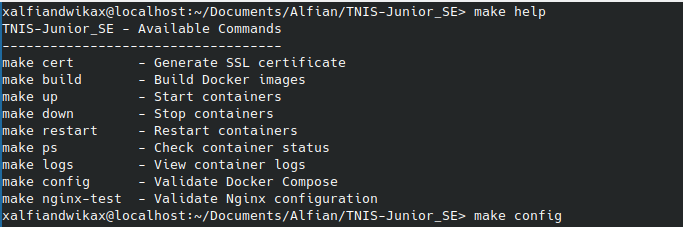
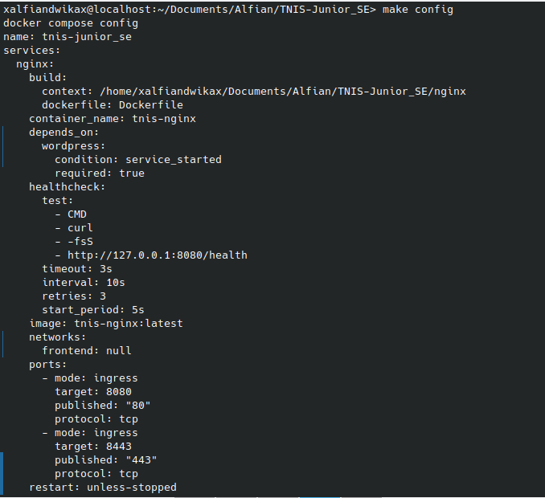
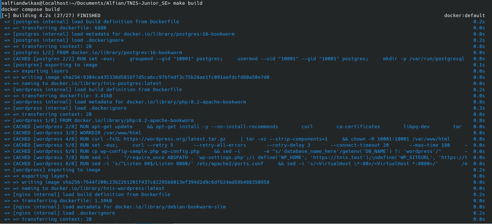
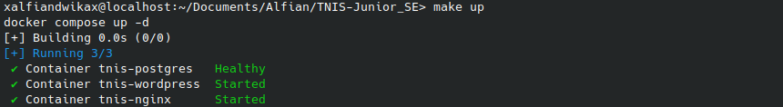
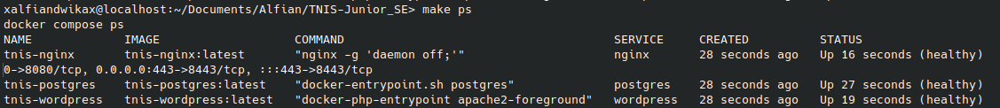
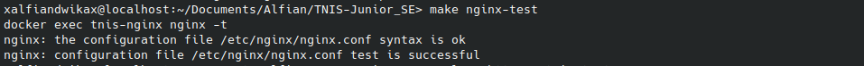
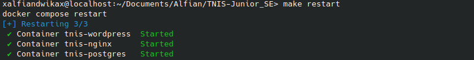
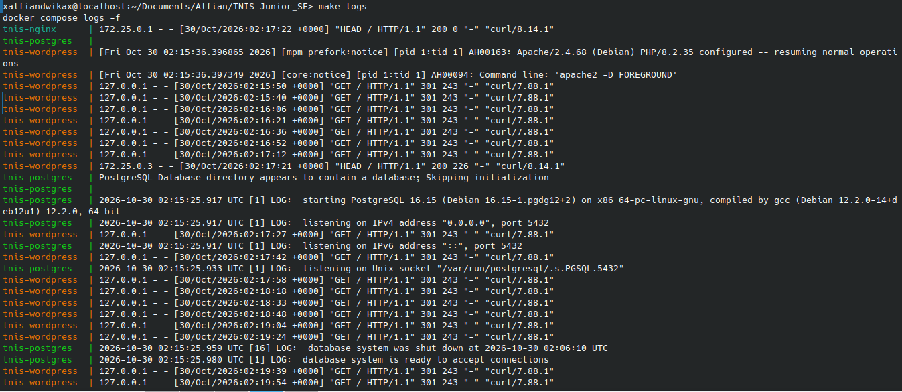
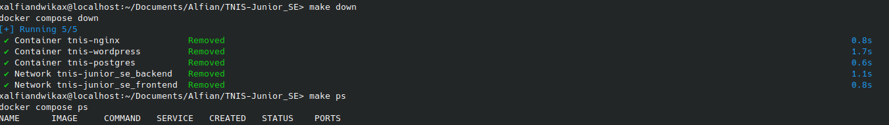

# Question 4 — Otomatisasi Pengelolaan Docker Menggunakan Makefile

## 1. Pendahuluan

Pada bagian ini, dilakukan implementasi **Makefile** untuk menyederhanakan pengelolaan layanan aplikasi yang berjalan menggunakan Docker Compose.

Makefile digunakan sebagai alat bantu otomatisasi agar beberapa perintah Docker Compose dapat dijalankan melalui perintah yang lebih singkat dan mudah diingat.

Tanpa Makefile, pengguna perlu mengetik perintah Docker Compose secara langsung setiap kali ingin membangun image, menjalankan container, memeriksa status layanan, melihat log, atau menghentikan layanan.

Dengan adanya Makefile, proses tersebut dapat dilakukan melalui satu perintah sederhana, seperti:

```bash
make build
make up
make ps
make down
```

Implementasi ini bertujuan untuk membuat proses pengelolaan lingkungan aplikasi menjadi lebih praktis, konsisten, dan mudah dipelihara.

## 2. Tujuan Implementasi

Tujuan dari implementasi Makefile ini adalah:

1. Menyederhanakan perintah Docker Compose menjadi perintah yang lebih mudah digunakan.
2. Mengotomatisasi proses pembangunan Docker Image.
3. Mempermudah proses menjalankan dan menghentikan layanan aplikasi.
4. Mempermudah pemeriksaan status container dan konfigurasi layanan.
5. Mempermudah pemantauan log dari setiap layanan.
6. Menyediakan perintah untuk melakukan validasi konfigurasi Nginx.
7. Menjaga data PostgreSQL tetap tersimpan meskipun container dihentikan atau dihapus.

## 3. Implementasi Makefile

Berikut merupakan isi Makefile yang digunakan dalam proyek ini:

```makefile
COMPOSE = docker compose

.PHONY: help cert build up down restart ps logs config nginx-test

# Menampilkan daftar perintah
help:
	@echo "TNIS-Junior_SE - Available Commands"
	@echo "-----------------------------------"
	@echo "make cert        - Generate SSL certificate"
	@echo "make build       - Build Docker images"
	@echo "make up          - Start containers"
	@echo "make down        - Stop containers"
	@echo "make restart     - Restart containers"
	@echo "make ps          - Check container status"
	@echo "make logs        - View container logs"
	@echo "make config      - Validate Docker Compose"
	@echo "make nginx-test  - Validate Nginx configuration"

# Membuat sertifikat SSL menggunakan mkcert
cert:
	mkdir -p nginx/certs
	mkcert -install
	mkcert -cert-file nginx/certs/tnis.test.crt -key-file nginx/certs/tnis.test.key tnis.test
	chmod 600 nginx/certs/tnis.test.key

# Build Docker images
build:
	$(COMPOSE) build

# Menjalankan container
up:
	$(COMPOSE) up -d

# Menghentikan container tanpa menghapus volume
down:
	$(COMPOSE) down

# Restart container
restart:
	$(COMPOSE) restart

# Melihat status container
ps:
	$(COMPOSE) ps

# Melihat log container
logs:
	$(COMPOSE) logs -f

# Validasi Docker Compose
config:
	$(COMPOSE) config

# Validasi konfigurasi Nginx
nginx-test:
	docker exec tnis-nginx nginx -t
```

### 3.1 Penjelasan Konfigurasi Makefile

**A. Variabel Docker Compose**

```makefile
COMPOSE = docker compose
```

Variabel `COMPOSE` digunakan untuk menyimpan perintah `docker compose`.

Tujuannya agar perintah Docker Compose tidak perlu ditulis berulang kali pada setiap bagian Makefile. Jika terdapat perubahan perintah di kemudian hari, cukup mengubah nilai variabel tersebut.

**B. Deklarasi Target**

```makefile
.PHONY: help cert build up down restart ps logs config nginx-test
```

Deklarasi `.PHONY` digunakan untuk menandai target sebagai perintah, bukan sebagai nama file.

Dengan demikian, Makefile tetap menjalankan target yang diminta meskipun terdapat file atau direktori dengan nama yang sama.

**C. Target Help**

```makefile
help:
	@echo "TNIS-Junior_SE - Available Commands"
```

Target `help` digunakan untuk menampilkan daftar perintah yang tersedia beserta fungsi singkatnya.

Perintah ini membantu pengguna mengetahui perintah yang dapat dijalankan tanpa harus membuka dan membaca seluruh isi Makefile.

**D. Target Cert**

```makefile
cert:
	mkdir -p nginx/certs
	mkcert -install
	mkcert -cert-file nginx/certs/tnis.test.crt -key-file nginx/certs/tnis.test.key tnis.test
	chmod 600 nginx/certs/tnis.test.key
```

Target `cert` digunakan untuk membuat sertifikat SSL lokal menggunakan `mkcert`.

Proses yang dilakukan:

1. Membuat direktori `nginx/certs` apabila belum tersedia.
2. Menginstal Certificate Authority lokal `mkcert` ke sistem.
3. Membuat sertifikat untuk domain `tnis.test`.
4. Menyimpan sertifikat dan private key pada direktori `nginx/certs`.
5. Mengatur izin akses private key menjadi `600` agar hanya pemilik file yang dapat membaca dan menulisnya.

Target ini membantu mengotomatisasi persiapan sertifikat HTTPS untuk lingkungan pengembangan lokal.

**E. Target Build**

```makefile
build:
	$(COMPOSE) build
```

Target `build` digunakan untuk membangun Docker Image berdasarkan konfigurasi yang terdapat pada `docker-compose.yml`.

Perintah ini membaca Dockerfile dari masing-masing layanan dan menjalankan proses pembangunan image yang dibutuhkan.

Dalam proyek ini, image yang dibangun meliputi:

- `tnis-postgres`
- `tnis-wordpress`
- `tnis-nginx`

Dengan demikian, seluruh image dapat dibangun melalui satu perintah tanpa harus menjalankan proses build untuk setiap layanan secara terpisah.

**F. Target Up**

```makefile
up:
	$(COMPOSE) up -d
```

Target `up` digunakan untuk menjalankan seluruh layanan yang telah didefinisikan dalam Docker Compose.

Opsi `-d` (detached mode) memungkinkan container berjalan di latar belakang sehingga terminal tetap dapat digunakan untuk menjalankan perintah lainnya.

Layanan yang dijalankan dalam proyek ini meliputi PostgreSQL, WordPress, dan Nginx.

**G. Target Down**

```makefile
down:
	$(COMPOSE) down
```

Target `down` digunakan untuk menghentikan dan menghapus container serta network yang dibuat oleh Docker Compose.

Perlu diperhatikan bahwa perintah ini tidak menggunakan opsi `-v`. Dengan demikian, named volume PostgreSQL tidak ikut dihapus.

Hal ini penting karena database menggunakan persistent volume agar data tetap tersedia ketika container dihentikan dan dijalankan kembali.

**H. Target Restart**

```makefile
restart:
	$(COMPOSE) restart
```

Target `restart` digunakan untuk memulai ulang seluruh container yang dikelola oleh Docker Compose.

Perintah ini berguna ketika layanan perlu dimulai ulang tanpa harus melakukan proses build ulang image.

**I. Target PS**

```makefile
ps:
	$(COMPOSE) ps
```

Target `ps` digunakan untuk melihat status container yang dikelola oleh Docker Compose.

Informasi yang ditampilkan meliputi nama container, image, status layanan, serta port yang digunakan.

Perintah ini dapat digunakan untuk memastikan seluruh layanan telah berjalan sesuai konfigurasi.

**J. Target Logs**

```makefile
logs:
	$(COMPOSE) logs -f
```

Target `logs` digunakan untuk menampilkan log dari seluruh layanan yang berjalan.

Opsi `-f` (follow) memungkinkan log ditampilkan secara langsung ketika terdapat aktivitas baru pada container.

Perintah ini berguna untuk membantu proses troubleshooting, seperti memeriksa kesalahan konfigurasi, kegagalan koneksi database, atau masalah saat layanan dijalankan.

Untuk menghentikan tampilan log, pengguna dapat menekan `Ctrl + C`. Tindakan tersebut hanya menghentikan pemantauan log di terminal, bukan menghapus data atau image container.

**K. Target Config**

```makefile
config:
	$(COMPOSE) config
```

Target `config` digunakan untuk memeriksa dan menampilkan konfigurasi Docker Compose setelah proses penggabungan konfigurasi dilakukan.

Perintah ini membantu memastikan struktur konfigurasi, service, network, volume, port, dan environment variable dapat dibaca oleh Docker Compose.

Validasi ini dapat dilakukan sebelum menjalankan container untuk mengurangi kemungkinan kesalahan konfigurasi.

**L. Target Nginx-Test**

```makefile
nginx-test:
	docker exec tnis-nginx nginx -t
```

Target `nginx-test` digunakan untuk melakukan pemeriksaan konfigurasi Nginx yang sedang berjalan di dalam container `tnis-nginx`.

Perintah `nginx -t` akan memeriksa sintaks dan validitas konfigurasi Nginx.

Apabila konfigurasi benar, Nginx akan memberikan informasi bahwa pengujian sintaks berhasil.

Perintah ini berguna untuk memastikan konfigurasi Nginx valid sebelum digunakan untuk melayani permintaan HTTP maupun HTTPS.

## 4. Daftar Perintah Makefile

Berikut adalah rangkuman perintah yang dapat digunakan:

| Perintah | Fungsi |
|---|---|
| `make help` | Menampilkan daftar perintah Makefile. |
| `make cert` | Membuat sertifikat SSL lokal menggunakan mkcert. |
| `make build` | Membangun Docker Image. |
| `make up` | Menjalankan seluruh container. |
| `make down` | Menghentikan dan menghapus container serta network tanpa menghapus volume. |
| `make restart` | Memulai ulang seluruh container. |
| `make ps` | Melihat status container. |
| `make logs` | Menampilkan log seluruh layanan secara langsung. |
| `make config` | Memvalidasi konfigurasi Docker Compose. |
| `make nginx-test` | Memeriksa sintaks konfigurasi Nginx. |

## 5. Pengujian Makefile

Setelah Makefile selesai dibuat, dilakukan pengujian terhadap setiap target untuk memastikan seluruh perintah dapat berjalan sesuai fungsinya.

Pengujian dilakukan pada lingkungan Linux openSUSE menggunakan Docker Compose.

### 5.1 Pengujian Help

Perintah:

```bash
make help
```

Hasil yang diharapkan:

Menampilkan seluruh daftar perintah Makefile beserta keterangan fungsinya.

Hasil pengujian:

Berhasil. Seluruh daftar perintah ditampilkan pada terminal.

### 5.2 Pengujian Config

Perintah:

```bash
make config
```

Hasil yang diharapkan:

Docker Compose dapat membaca dan memvalidasi konfigurasi layanan tanpa menghasilkan kesalahan konfigurasi.

Hasil pengujian:

Berhasil. Konfigurasi service, network, volume, dan port dapat ditampilkan.

### 5.3 Pengujian Build

Perintah:

```bash
make build
```

Hasil yang diharapkan:

Docker berhasil membangun image untuk seluruh layanan yang didefinisikan dalam Docker Compose.

Hasil pengujian:

Berhasil. Ketiga image berhasil dibangun:

- `tnis-postgres:latest`
- `tnis-wordpress:latest`
- `tnis-nginx:latest`

### 5.4 Pengujian Up

Perintah:

```bash
make up
```

Hasil yang diharapkan:

Seluruh container berhasil dibuat dan dijalankan dalam mode background.

Hasil pengujian:

Berhasil. Container PostgreSQL, WordPress, dan Nginx berhasil dijalankan.

PostgreSQL juga menunjukkan status `Healthy`.

### 5.5 Pengujian PS

Perintah:

```bash
make ps
```

Hasil yang diharapkan:

Menampilkan daftar container beserta status dan port yang digunakan.

Hasil pengujian:

Berhasil. Ketiga layanan dapat ditampilkan melalui Docker Compose.

### 5.6 Pengujian Nginx-Test

Perintah:

```bash
make nginx-test
```

Hasil yang diharapkan:

Nginx berhasil memvalidasi konfigurasi tanpa kesalahan sintaks.

Hasil pengujian:

Berhasil. Terminal menampilkan pesan:

```text
nginx: the configuration file /etc/nginx/nginx.conf syntax is ok
nginx: configuration file /etc/nginx/nginx.conf test is successful
```

### 5.7 Pengujian Restart

Perintah:

```bash
make restart
```

Hasil yang diharapkan:

Seluruh container berhasil dimulai ulang tanpa harus membangun ulang Docker Image.

Hasil pengujian:

Berhasil. Container PostgreSQL, WordPress, dan Nginx berhasil dimulai ulang.

### 5.8 Pengujian Logs

Perintah:

```bash
make logs
```

Hasil yang diharapkan:

Menampilkan log dari seluruh container secara langsung.

Hasil pengujian:

Berhasil. Log dari Nginx, WordPress, dan PostgreSQL berhasil ditampilkan.

Pemantauan dihentikan menggunakan `Ctrl + C`. Hal ini merupakan tindakan normal karena opsi `-f` menjalankan pemantauan log secara terus-menerus.

### 5.9 Pengujian Down

Perintah:

```bash
make down
```

Hasil yang diharapkan:

Seluruh container dan network yang dikelola Docker Compose dihentikan dan dihapus, sementara named volume tetap dipertahankan.

Hasil pengujian:

Berhasil. Container dan network berhasil dihapus.

Named volume PostgreSQL `tnis-junior_se_postgres_data` tetap tersedia sehingga data database tidak ikut terhapus.

## 6. Ringkasan Hasil Pengujian

| No. | Perintah | Hasil |
|---|---|---|
| 1 | `make help` | Berhasil |
| 2 | `make config` | Berhasil |
| 3 | `make build` | Berhasil |
| 4 | `make up` | Berhasil |
| 5 | `make ps` | Berhasil |
| 6 | `make nginx-test` | Berhasil |
| 7 | `make restart` | Berhasil |
| 8 | `make logs` | Berhasil |
| 9 | `make down` | Berhasil |

**Catatan:** Target `make cert` telah diimplementasikan pada Makefile, tetapi tidak termasuk dalam rangkaian pengujian yang didokumentasikan pada bagian ini.

## 7. Dokumentasi Hasil Pengujian

Berikut merupakan bukti pelaksanaan pengujian setiap perintah Makefile.

### 7.1 Pengujian Help



Gambar menunjukkan daftar perintah yang tersedia pada Makefile beserta keterangan masing-masing fungsi.

### 7.2 Pengujian Config



Gambar menunjukkan hasil pemeriksaan konfigurasi Docker Compose.

### 7.3 Pengujian Build



Gambar menunjukkan proses pembangunan Docker Image untuk layanan PostgreSQL, WordPress, dan Nginx.

### 7.4 Pengujian Up



Gambar menunjukkan proses menjalankan seluruh container menggunakan Docker Compose.

### 7.5 Pengujian PS



Gambar menunjukkan status container setelah seluruh layanan berhasil dijalankan.

### 7.6 Pengujian Nginx-Test



Gambar menunjukkan hasil validasi konfigurasi Nginx yang berhasil tanpa kesalahan sintaks.

### 7.7 Pengujian Restart



Gambar menunjukkan proses memulai ulang seluruh container.

### 7.8 Pengujian Logs



Gambar menunjukkan log aktivitas dari layanan Nginx, WordPress, dan PostgreSQL.

### 8.9 Pengujian Down



Gambar menunjukkan proses penghentian dan penghapusan container serta network. Named volume PostgreSQL tetap dipertahankan.

## 9. Kesimpulan

Berdasarkan implementasi dan pengujian yang telah dilakukan, Makefile berhasil digunakan untuk menyederhanakan pengelolaan layanan Docker Compose pada proyek TNIS-Junior_SE.

Seluruh sembilan target yang diuji berhasil dijalankan sesuai dengan fungsi masing-masing, mulai dari pemeriksaan konfigurasi, pembangunan Docker Image, menjalankan container, pemantauan log, hingga menghentikan layanan.

Penggunaan Makefile memberikan beberapa manfaat, yaitu:

1. **Efisiensi:** Mengurangi kebutuhan untuk mengetik perintah Docker Compose yang panjang secara berulang.
2. **Konsistensi:** Menyediakan perintah standar untuk mengelola seluruh layanan.
3. **Kemudahan pemeliharaan:** Mempermudah pemeriksaan status, log, dan konfigurasi layanan.
4. **Keamanan data:** Penggunaan `docker compose down` tanpa opsi `-v` menjaga named volume PostgreSQL tetap tersedia.

Dengan demikian, Makefile dapat membantu meningkatkan efisiensi pengelolaan lingkungan aplikasi berbasis Docker serta mempermudah proses operasional dan pemeliharaan layanan.