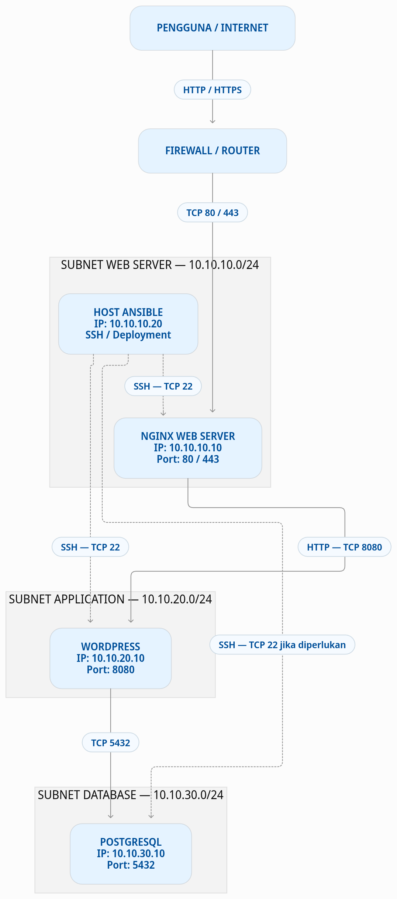

# 5. Infrastructure & Networking

## 1. Pendahuluan

Pada bagian ini dilakukan perancangan topologi jaringan untuk infrastruktur aplikasi yang terdiri dari Nginx sebagai Web Server, WordPress sebagai Application Server, dan PostgreSQL sebagai Database Server.

Perancangan menggunakan tiga subnet berbeda untuk memisahkan setiap komponen berdasarkan fungsinya. Pemisahan ini bertujuan meningkatkan keamanan, mempermudah pengelolaan jaringan, serta membatasi komunikasi antar-komponen sesuai kebutuhan.

## 2. Tujuan Perancangan

Tujuan dari perancangan infrastruktur jaringan ini adalah:

- Membuat segmentasi jaringan berdasarkan fungsi layanan.
- Menentukan alokasi IP address untuk setiap komponen.
- Mengatur komunikasi antar-server berdasarkan kebutuhan port.
- Membatasi akses langsung ke database dari jaringan eksternal.
- Menyediakan akses administrasi dan deployment menggunakan Ansible.

## 3. Topologi Jaringan

Topologi jaringan dibagi menjadi tiga subnet:

| Subnet | Network Address | Komponen |
|---|---|---|
| Web Server | 10.10.10.0/24 | Nginx |
| Application Server | 10.10.20.0/24 | WordPress |
| Database Server | 10.10.30.0/24 | PostgreSQL |

Diagram topologi jaringan:

  

Alur komunikasi:

1. Pengguna mengakses aplikasi melalui HTTP atau HTTPS.
2. Firewall meneruskan koneksi ke Nginx.
3. Nginx meneruskan request ke WordPress.
4. WordPress melakukan koneksi ke PostgreSQL untuk mengakses data.
5. Ansible digunakan untuk administrasi dan deployment melalui SSH.

## 4. Alokasi IP Address

Berikut rancangan alokasi IP address untuk setiap komponen:

| Komponen | IP Address | Subnet | Fungsi |
|---|---|---|---|
| Gateway Web | 10.10.10.1 | 10.10.10.0/24 | Gateway subnet Web |
| Nginx | 10.10.10.10 | 10.10.10.0/24 | Reverse proxy dan HTTPS |
| Host Ansible | 10.10.10.20 | 10.10.10.0/24 | Administrasi dan deployment |
| Gateway App | 10.10.20.1 | 10.10.20.0/24 | Gateway subnet Application |
| WordPress | 10.10.20.10 | 10.10.20.0/24 | Application Server |
| Gateway DB | 10.10.30.1 | 10.10.30.0/24 | Gateway subnet Database |
| PostgreSQL | 10.10.30.10 | 10.10.30.0/24 | Database Server |

**Catatan:** Alokasi IP di atas merupakan rancangan jaringan (proposed design). IP gateway dan IP masing-masing layanan belum dikonfigurasi pada Docker Compose yang sedang berjalan.

## 5. Penjelasan Subnet

### 5.1 Subnet Web Server — 10.10.10.0/24

Subnet ini digunakan untuk komponen yang berhubungan langsung dengan akses pengguna.

Komponen:
- Nginx: 10.10.10.10
- Host Ansible: 10.10.10.20

Nginx berfungsi sebagai reverse proxy yang menerima request HTTP/HTTPS dan meneruskannya ke WordPress.

### 5.2 Subnet Application — 10.10.20.0/24

Subnet ini digunakan untuk menjalankan aplikasi WordPress.

Komponen:
- WordPress: 10.10.20.10

WordPress menerima request dari Nginx dan melakukan komunikasi dengan PostgreSQL untuk kebutuhan penyimpanan data.

### 5.3 Subnet Database — 10.10.30.0/24

Subnet ini digunakan khusus untuk layanan database.

Komponen:
- PostgreSQL: 10.10.30.10

PostgreSQL menyimpan data aplikasi WordPress. Akses database dibatasi hanya untuk layanan yang membutuhkan koneksi database, yaitu WordPress dan administrator yang berwenang.

## 6. Firewall Rules

Untuk meningkatkan keamanan, komunikasi antar-subnet dibatasi berdasarkan kebutuhan layanan.

| Source | Destination | Port | Keterangan |
|---|---|---|---|
| Internet | Nginx | TCP 80 | HTTP |
| Internet | Nginx | TCP 443 | HTTPS |
| Nginx | WordPress | TCP 8080 | Reverse proxy |
| WordPress | PostgreSQL | TCP 5432 | Koneksi database |
| Ansible | Nginx | TCP 22 | SSH administrasi |
| Ansible | WordPress | TCP 22 | SSH deployment |
| Ansible | PostgreSQL | TCP 22 | SSH jika diperlukan |

Aturan keamanan yang diterapkan:

- Database tidak boleh diakses langsung dari Internet.
- WordPress tidak perlu diekspos langsung ke Internet.
- Akses PostgreSQL hanya diberikan kepada layanan yang membutuhkan.
- Port SSH hanya dibuka untuk host administrasi yang diizinkan.
- Koneksi lain yang tidak diperlukan sebaiknya ditolak secara default (default deny).

## 7. Alasan Pemisahan Subnet

Pemisahan subnet dilakukan berdasarkan beberapa pertimbangan:

**1. Keamanan (Security)**

Memisahkan database dari jaringan yang berhubungan langsung dengan pengguna dapat mengurangi risiko akses tidak sah.

**2. Segmentasi Jaringan (Network Segmentation)**

Setiap layanan memiliki subnet sendiri sehingga pengaturan komunikasi dan kebijakan firewall dapat diterapkan secara lebih terstruktur.

**3. Kemudahan Pengelolaan (Manageability)**

Administrator dapat mengelola setiap kelompok layanan secara terpisah dan lebih mudah melakukan troubleshooting.

**4. Skalabilitas (Scalability)**

Jika kebutuhan aplikasi meningkat, setiap subnet dapat dikembangkan tanpa harus mengubah keseluruhan desain jaringan.

**5. Pembatasan Akses (Access Control)**

Komunikasi antar-komponen dapat dibatasi berdasarkan port dan sumber koneksi yang diperlukan.

## 8. Perhitungan Subnet

Ketiga subnet menggunakan prefix `/24`.

| Parameter | Nilai |
|---|---|
| Subnet Mask | 255.255.255.0 |
| Total IP Address | 256 |
| Usable IP Address | 254 |
| Network Address | x.x.x.0 |
| Broadcast Address | x.x.x.255 |

Dengan prefix `/24`, setiap subnet menyediakan 254 alamat IP yang dapat digunakan untuk perangkat atau layanan jaringan.

## 9. Pertimbangan Implementasi

Pada implementasi saat ini, layanan Nginx, WordPress, dan PostgreSQL dijalankan menggunakan Docker Compose pada satu host Linux.

Rancangan tiga subnet pada dokumen ini merupakan desain topologi yang diusulkan. Untuk menerapkannya secara aktual diperlukan konfigurasi Docker bridge network dengan subnet dan IP statis, serta pengaturan routing dan firewall agar komunikasi antar-subnet dapat berjalan.

Host Ansible juga harus memiliki konektivitas jaringan dan akses SSH yang sesuai dengan target deployment.

Dengan demikian, diagram ini menggambarkan rancangan infrastruktur jaringan yang dituju, bukan bukti bahwa ketiga subnet sudah aktif pada environment saat ini.

## 10. Kesimpulan

Perancangan infrastruktur jaringan ini menggunakan tiga subnet terpisah untuk Web Server, Application Server, dan Database Server.

Nginx berperan sebagai pintu masuk aplikasi, WordPress menangani proses aplikasi, sedangkan PostgreSQL bertanggung jawab terhadap penyimpanan data. Ansible digunakan sebagai sarana administrasi dan otomatisasi deployment.

Pemisahan subnet dan pembatasan komunikasi melalui firewall diharapkan dapat meningkatkan keamanan, kemudahan pengelolaan, serta skalabilitas infrastruktur aplikasi.