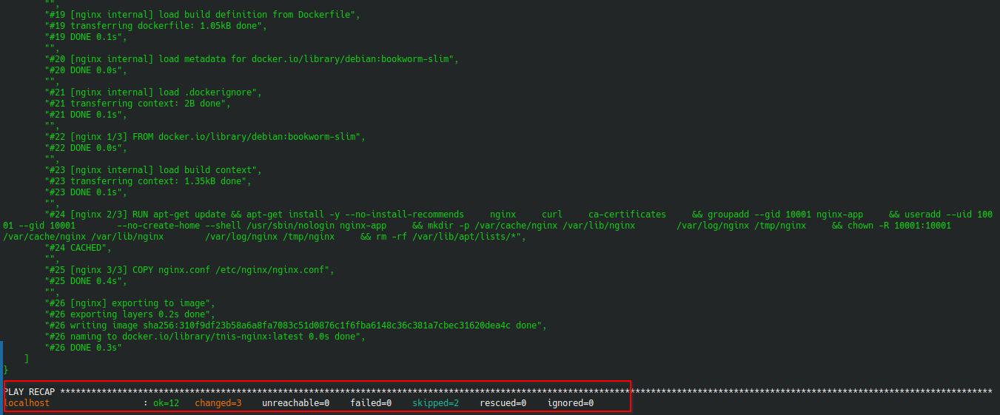
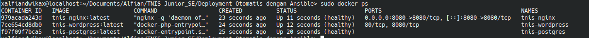
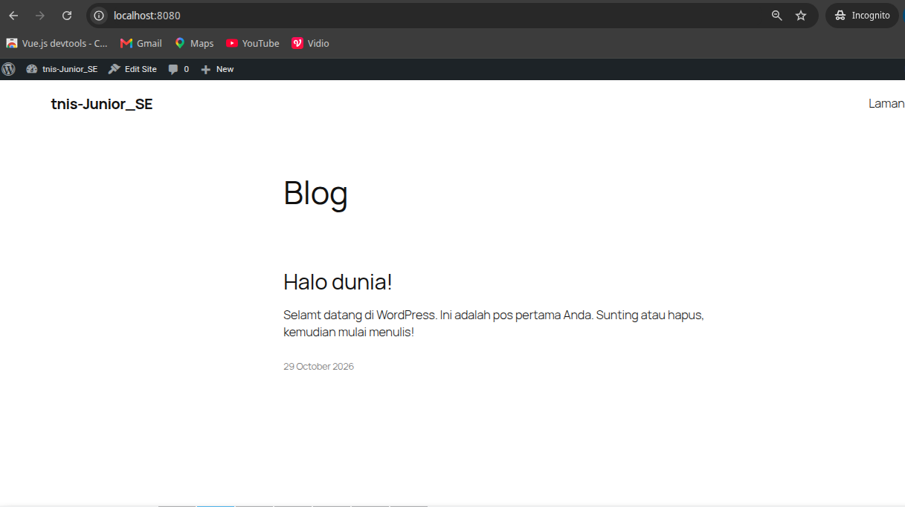
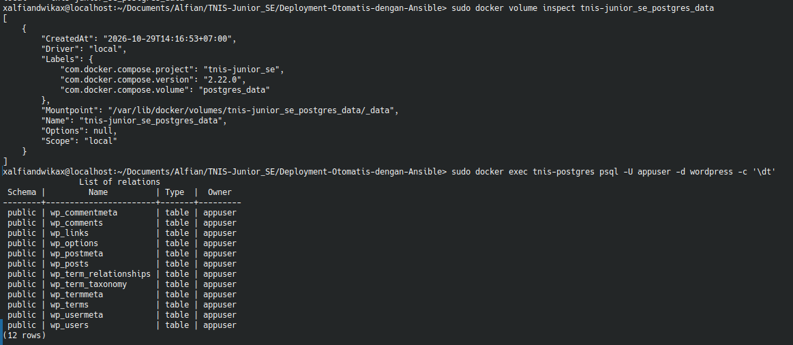

# Deployment Otomatis Menggunakan Ansible

## 1. Deskripsi

Proyek ini merupakan implementasi otomasi deployment aplikasi menggunakan Ansible dan Docker Compose. Ansible digunakan untuk memeriksa kebutuhan deployment, memastikan Docker berjalan, menyalin file proyek ke direktori target, dan menjalankan layanan aplikasi secara otomatis.

Aplikasi terdiri dari tiga container utama:
- **Nginx** — reverse proxy dan akses aplikasi.
- **WordPress** — aplikasi web.
- **PostgreSQL** — database untuk penyimpanan data.

Deployment telah diuji pada mesin lokal berbasis openSUSE.

## 2. Tujuan

- Mengotomatisasi deployment aplikasi menggunakan Ansible.
- Memastikan Docker dan Docker Compose tersedia.
- Menjalankan container menggunakan Docker Compose.
- Mempertahankan data PostgreSQL menggunakan persistent volume.
- Memudahkan proses deployment dan verifikasi layanan.

## 3. Teknologi yang Digunakan

| Teknologi | Keterangan |
|---|---|
| openSUSE Linux | Sistem operasi mesin deployment |
| Ansible Core 2.18.3 | Otomasi deployment |
| Docker | Container runtime |
| Docker Compose | Pengelolaan layanan multi-container |
| Nginx | Reverse proxy |
| WordPress | Aplikasi web |
| PostgreSQL | Database |

## 4. Konfigurasi Ansible

### 4.1. Ansible Configuration

File `ansible.cfg`:

```ini
[defaults]
inventory = ./inventory.ini
host_key_checking = True
```

Konfigurasi tersebut menentukan inventory default dan mempertahankan pemeriksaan host key SSH.

### 4.2. Inventory

File `inventory.ini`:

```ini
[deployment]
localhost ansible_connection=local ansible_become=true
```

Inventory ini menggunakan koneksi lokal. Dengan demikian, playbook dijalankan pada mesin yang sama, bukan pada server remote.

## 5. Alur Deployment

Playbook `deploy.yml` menjalankan tahapan berikut:

1. Memeriksa apakah Docker sudah terpasang.
2. Memasang Docker pada openSUSE apabila belum tersedia.
3. Memverifikasi instalasi Docker dan Docker Compose.
4. Memastikan service Docker berjalan dan aktif saat boot.
5. Memverifikasi keberadaan volume PostgreSQL.
6. Membuat direktori deployment di `/opt/tnis-junior-se`.
7. Menyalin file proyek ke direktori target.
8. Memastikan file `.env` tersedia dan mengatur permission-nya.
9. Menjalankan Docker Compose untuk membangun dan menjalankan layanan.

Perintah Docker Compose yang dijalankan oleh playbook:

```bash
docker compose up -d --build
```

## 6. Cara Menjalankan Deployment

### Prasyarat

- Ansible sudah terpasang.
- Docker dan Docker Compose tersedia atau dapat dipasang oleh playbook.
- File proyek dan `.env` tersedia di direktori sumber.
- Volume PostgreSQL yang diperlukan sudah tersedia.

### Langkah 1 — Masuk ke direktori

```bash
cd ~/Documents/Alfian/TNIS-Junior_SE/Deployment-Otomatis-dengan-Ansible
```

### Langkah 2 — Validasi sintaks

```bash
sudo ansible-playbook deploy.yml --syntax-check
```

### Langkah 3 — Jalankan deployment

```bash
sudo ansible-playbook deploy.yml
```

### Langkah 4 — Periksa container

```bash
sudo docker ps
```

### Langkah 5 — Akses aplikasi

Buka browser dan kunjungi:

http://localhost:8080

Pastikan aplikasi dapat diakses sebelum menyatakan pengujian browser berhasil.

## 7. Hasil Pengujian Deployment

Deployment berhasil dijalankan menggunakan perintah:

```bash
sudo ansible-playbook deploy.yml
```

Ringkasan hasil eksekusi:

```text
ok=12
changed=3
unreachable=0
failed=0
skipped=2
```

Hasil tersebut menunjukkan playbook selesai tanpa task yang gagal atau host yang tidak dapat dijangkau.

### Status Container

Berdasarkan pemeriksaan `docker ps`, ketiga container berjalan dengan status `healthy`.

| Container | Image | Status | Port |
|---|---|---|---|
| `tnis-nginx` | `tnis-nginx:latest` | Healthy | `8080:8080` |
| `tnis-wordpress` | `tnis-wordpress:latest` | Healthy | — |
| `tnis-postgres` | `tnis-postgres:latest` | Healthy | — |

### Verifikasi PostgreSQL Volume

Nama volume yang digunakan:

```text
tnis-junior_se_postgres_data
```

Perintah pemeriksaan:

```bash
sudo docker volume inspect tnis-junior_se_postgres_data
```

Volume ini digunakan untuk mempertahankan data PostgreSQL di luar siklus hidup container.

## 8. Dokumentasi Screenshot

### 8.1. Hasil Eksekusi Ansible

Screenshot terminal yang menunjukkan playbook selesai tanpa kegagalan.



### 8.2. Status Container Docker

Screenshot output `sudo docker ps` yang menunjukkan container Nginx, WordPress, dan PostgreSQL berjalan dengan status sehat.



### 8.3. Pengujian Aplikasi

Screenshot aplikasi melalui browser setelah berhasil diakses pada `http://localhost:8080`.



### 8.4. Verifikasi Volume PostgreSQL

Screenshot output pemeriksaan volume menggunakan `docker volume inspect`.




## 9. Keamanan dan Catatan

- File `.env` berisi konfigurasi sensitif. Jangan menampilkan password asli pada dokumentasi atau mengunggahnya ke repository publik.
- Permission file `.env` pada direktori deployment diatur menjadi `0600`.
- Deployment yang telah diuji menggunakan inventory `localhost`.
- Deployment ke VM atau server remote belum dikonfirmasi.
- Sebelum deployment pada server lain, pastikan koneksi SSH, akses privilege, Docker Compose, konfigurasi environment, dan kebutuhan persistent volume telah disiapkan.

## 10. Kesimpulan

Implementasi Ansible berhasil menjalankan otomasi deployment Docker Compose pada mesin lokal. Ketiga container, yaitu Nginx, WordPress, dan PostgreSQL, terpantau berjalan dengan status `healthy`. Volume PostgreSQL juga tersedia untuk mendukung penyimpanan data persisten.

Dokumentasi ini mencakup konfigurasi Ansible, tahapan deployment, hasil pengujian, dan bukti screenshot sebagai referensi pelaksanaan tugas.
