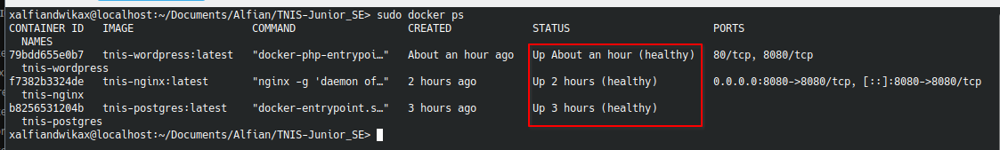
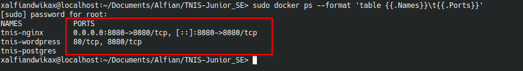
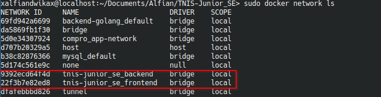
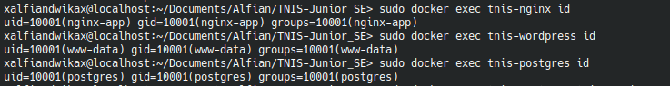
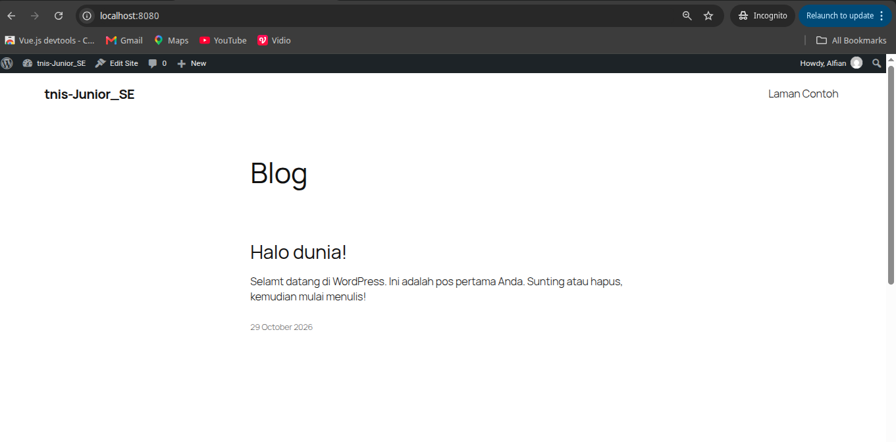
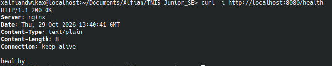
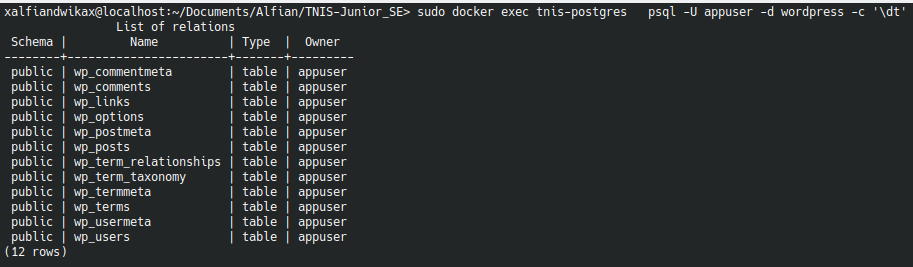

# Soal 1 — Docker & Docker Compose

**Nama Kandidat:** Alfian Dwika  
**Posisi:** Junior System Engineer  
**Topik:** Containerization menggunakan Docker dan Docker Compose

## 1. Deskripsi

Membangun lingkungan aplikasi menggunakan Docker dan Docker Compose yang terdiri dari tiga layanan:

- **Nginx:** Reverse proxy untuk meneruskan request HTTP ke WordPress.
- **WordPress:** Aplikasi web.
- **PostgreSQL:** Database untuk menyimpan data aplikasi.

Setiap layanan dikonfigurasi menggunakan Dockerfile dan Docker Compose.

## 2. Arsitektur

```text
Client / Browser
       |
       | HTTP :8080
       v
+------------------+
|      Nginx       |
|  Reverse Proxy   |
+------------------+
       |
  Frontend Network
       |
       v
+------------------+
|    WordPress     |
|    Web App       |
+------------------+
       |
   Backend Network
       |
       v
+------------------+
|   PostgreSQL     |
|    Database      |
+------------------+
```

**Keterangan jaringan:**

- Nginx terhubung ke jaringan `frontend`.
- WordPress terhubung ke jaringan `frontend` dan `backend`.
- PostgreSQL hanya terhubung ke jaringan `backend`.
- Port `8080` dipublikasikan ke host melalui Nginx.
- Port PostgreSQL `5432` tidak dipublikasikan langsung ke host.

## 3. Konfigurasi dan Menjalankan Aplikasi

### 3.1 Memeriksa konfigurasi Docker Compose

```bash
sudo docker compose config
```

Perintah ini digunakan untuk memvalidasi konfigurasi Docker Compose.

### 3.2 Build dan menjalankan container

```bash
sudo docker compose up -d --build
```

Perintah ini membangun image dan menjalankan layanan di background.

### 3.3 Memeriksa status container

```bash
sudo docker compose ps
```

Perintah ini digunakan untuk memeriksa status layanan yang dijalankan.

**Screenshot:**



### 3.4 Memeriksa log aplikasi

```bash
sudo docker compose logs --tail=100
```

Perintah ini digunakan untuk melihat log layanan dan membantu proses troubleshooting.

## 4. Pengujian Aplikasi

### 4.1 Memeriksa port yang dipublikasikan

```bash
sudo docker ps --format 'table {{.Names}}\t{{.Ports}}'
```

Hasil pemeriksaan menunjukkan bahwa Nginx menggunakan port host `8080`, sedangkan PostgreSQL tidak dipublikasikan langsung ke host.

**Screenshot:**



### 4.2 Memeriksa jaringan Docker

```bash
sudo docker network ls
```

Untuk melihat detail jaringan, gunakan nama jaringan yang sesuai dengan hasil pemeriksaan:

```bash
sudo docker network inspect NAMA_NETWORK
```

Pemeriksaan ini digunakan untuk memverifikasi jaringan yang digunakan oleh setiap layanan.

**Screenshot:**



### 4.3 Memeriksa user dalam container

```bash
sudo docker exec tnis-nginx id
sudo docker exec tnis-wordpress id
sudo docker exec tnis-postgres id
```

Perintah ini digunakan untuk memeriksa user dan grup yang menjalankan proses dalam setiap container.

**Screenshot:**



### 4.4 Menguji akses WordPress melalui Nginx

```bash
curl -sS -D - -o /dev/null http://localhost:8080/
```
(screenshots/09-pengujian-acces-8080.png)

Hasil pengujian menunjukkan respons HTTP `200 OK`, yang menandakan bahwa homepage WordPress dapat diakses melalui Nginx.

**Screenshot:**



### 4.5 Menguji endpoint health check

```bash
curl -i http://localhost:8080/health
```

Endpoint mengembalikan HTTP `200 OK` dengan isi respons `healthy`.

**Screenshot:**



## 5. Integrasi WordPress dan PostgreSQL

WordPress secara default mendukung MySQL/MariaDB. Pada proyek ini, PostgreSQL digunakan melalui adapter pihak ketiga PG4WP.

### 5.1 Memeriksa tabel database

```bash
sudo docker exec tnis-postgres \
  psql -U appuser -d wordpress -c '\dt'
```

Hasil pemeriksaan menunjukkan bahwa 12 tabel WordPress telah terbentuk di database `wordpress` dan dimiliki oleh user `appuser`.

**Screenshot:**



**Catatan:** Terbentuknya tabel dan berhasilnya akses homepage merupakan hasil pengujian awal. Kompatibilitas seluruh fitur WordPress dengan PostgreSQL tetap perlu diuji karena integrasi ini menggunakan adapter pihak ketiga.

## 6. Keamanan dan Isolasi

Konfigurasi yang diterapkan meliputi:

- PostgreSQL tidak dipublikasikan langsung ke host.
- Nginx digunakan sebagai pintu masuk akses HTTP ke aplikasi.
- Jaringan `frontend` dan `backend` dipisahkan sesuai kebutuhan komunikasi layanan.

## 7. Kesimpulan

Lingkungan aplikasi berhasil dijalankan menggunakan Docker Compose dengan Nginx sebagai reverse proxy, WordPress sebagai aplikasi web, dan PostgreSQL sebagai database.

Hasil pengujian menunjukkan bahwa homepage WordPress merespons HTTP `200 OK`, endpoint health check berfungsi, dan 12 tabel WordPress ditemukan di PostgreSQL.